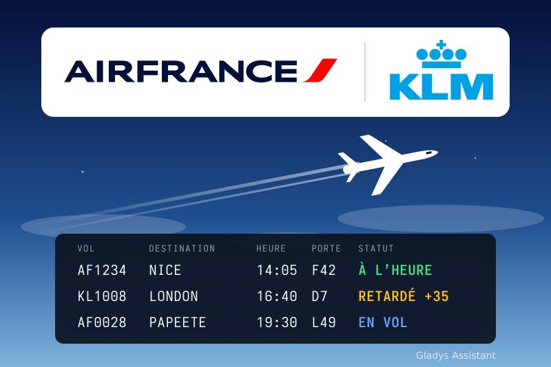
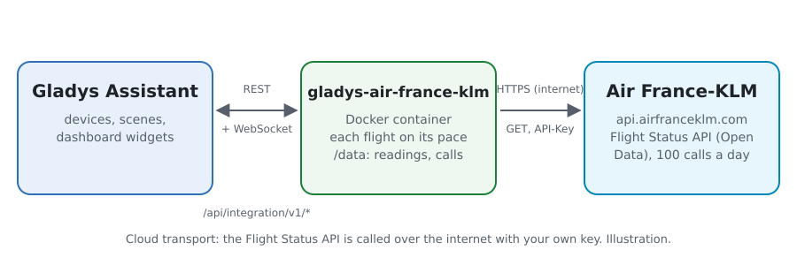
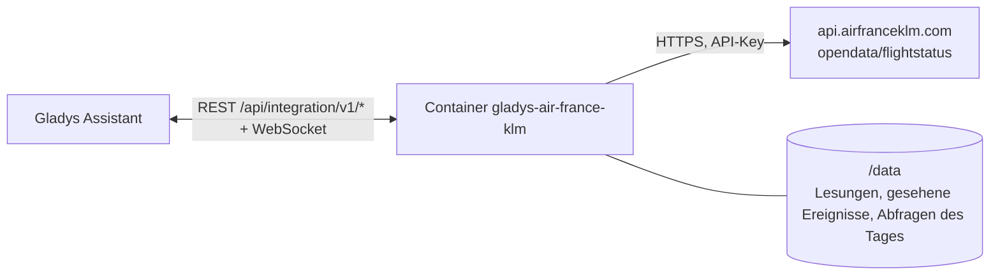
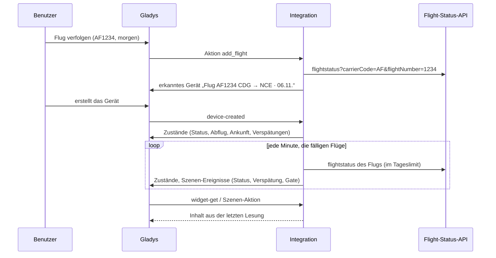
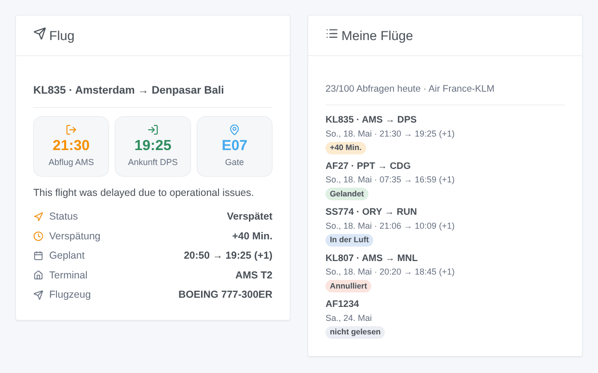

# Gladys Air France-KLM

[English](README.md) · [Français](README.fr.md) · **Deutsch** · [Español](README.es.md)

[](LICENSE)
[](https://github.com/William-De71/gladys-air-france-klm/releases)
[](https://github.com/William-De71/gladys-air-france-klm/actions/workflows/release.yml)
[](https://gladysassistant.com)



Externe Integration für [Gladys Assistant](https://gladysassistant.com) für **Flüge mit Air France und KLM**: Verfolgen Sie Ihre Flüge (Status, Verspätungen, Gate, Gepäckband) und werden Sie benachrichtigt, wenn sie sich verspäten, starten, landen oder das Gate wechseln, mit Szenen und Dashboard-Widgets. Sie liest die offizielle Flight-Status-API von Air France-KLM mit dem kostenlosen Schlüssel Ihrer eigenen Anwendung.

Benutzerdokumentation: [English](docs/en.md) · [Français](docs/fr.md) · [Deutsch](docs/de.md) · [Español](docs/es.md).

> Community-Integration, weder mit Air France, KLM oder der Air-France-KLM-Gruppe verbunden noch von ihnen unterstützt. Air France, KLM und ihre Logos sind Marken ihrer Inhaber.

## Funktionen

- **Ein Gerät pro verfolgtem Flug** (bis zu 10, hinzugefügt mit der Schaltfläche **Flug verfolgen**): eine Flugnummer (AF1234, KL 1008) und ihr Datum, bei einem Flug mit Zwischenstopp die Flughäfen, an denen Sie ein- und aussteigen.
- Pro Flug: der Status (pünktlich, verspätet, in der Luft, gelandet, annulliert, umgeleitet), Abflug und Ankunft (Ortszeit, geplante Zeit, Terminal, Gate, Gepäckband) sowie Abflug- und Ankunftsverspätung in Minuten.
- **3 Szenen-Auslöser**, **2 Szenen-Aktionen** und **2 Dashboard-Widgets** (unten), mit dem von der Fluggesellschaft genannten Grund einer Verspätung oder Annullierung.
- Jeder Flug wird umso häufiger gelesen, je näher der Abflug rückt (einige Tage vorher alle 12 Stunden, in den letzten zwei Stunden alle 15 Minuten), nach der Landung gar nicht mehr, innerhalb eines Tageslimits an Abfragen (100 im kostenlosen Tarif). Die Lesungen und die Abfragen des Tages bleiben in `/data` über Neustarts erhalten.
- Konfigurationsschaltflächen: Verbindung testen, Flüge verfolgen / nicht mehr verfolgen / auflisten.
- Überall vier Sprachen: Englisch, Französisch, Deutsch, Spanisch.

## Funktionsweise





Die Flight-Status-API liefert für eine Flugnummer rund um ein Datum den durchgeführten Flug: seine Strecke, eine Teilstrecke pro Abschnitt, die geplanten, zuletzt veröffentlichten und tatsächlichen Zeiten in der Ortszeit jedes Flughafens, Terminal, Gate und Gepäckband, die Verspätungen und ihre öffentlichen Gründe. Die Integration wählt den Flug des verfolgten Datums (und die Teilstrecken zwischen den gewählten Flughäfen), leitet aus den tatsächlichen Zeiten und dem Flugstatus einen Status ab und vergleicht ihn mit der vorherigen Lesung, um die Szenen-Auslöser auszulösen.



### Transport

Nur Cloud (`"transports": ["cloud"]`): Der Katalog zeigt das Cloud-Abzeichen. Die Integration kontaktiert `api.airfranceklm.com` mit Ihrem Schlüssel; nur die Nummern und Daten der verfolgten Flüge werden gesendet. Es gibt keinen lokalen Zugang, daher keine Schaltfläche „Lokale Verbindung bevorzugen“.

## Geräte und Funktionen

| Gerät                                   | Funktion           | Kategorie / Typ        | Werte                                               |
| --------------------------------------- | ------------------ | ---------------------- | --------------------------------------------------- |
| Flug \<Nummer\> \<Strecke\> · \<Datum\> | Flugstatus         | `text` / `text`        | „Verspätet“, „In der Luft“, „Gelandet“…             |
| Flug \<Nummer\> \<Strecke\> · \<Datum\> | Abflug             | `text` / `text`        | „14:35 (geplant 14:05) · CDG T2F · Gate F42“        |
| Flug \<Nummer\> \<Strecke\> · \<Datum\> | Ankunft            | `text` / `text`        | „16:10 · NCE T2 · Gepäckband 5“, „(+1)“ am Folgetag |
| Flug \<Nummer\> \<Strecke\> · \<Datum\> | Abflugverspätung   | `duration` / `integer` | Minuten, −2880 … 2880 (negativ bei Verfrühung)      |
| Flug \<Nummer\> \<Strecke\> · \<Datum\> | Ankunftsverspätung | `duration` / `integer` | Minuten, −2880 … 2880                               |

Die externe ID eines Geräts ist eine zufällige Kennung, die beim Verfolgen des Flugs vergeben wird, nie eine Flugnummer: AF1234 fliegt jeden Tag, jedes Datum hat sein eigenes Gerät.

## Szenen-Auslöser, Aktionen und Widgets



**Szenen-Auslöser** (das erste Lesen eines Flugs ist ein Ausgangswert und löst nichts aus):

- **Flugstatus geändert**: verspätet, gestartet, gelandet, annulliert oder umgeleitet, mit dem vorherigen Status, den Zeiten, dem Gate, der Verspätung, dem Grund und einer Zusammenfassung. Filter: Flug, neuer Status.
- **Flugverspätung geändert**: Die Verspätung hat sich um 15 Minuten oder mehr verschoben (bis zum Start die des Abflugs, danach die der Ankunft). Filter: Flug.
- **Gate bekannt oder geändert**: mit dem vorherigen Gate und dem Terminal. Filter: Flug.

**Szenen-Aktionen**: **Verfolgten Flug lesen** (neu gelesen, wenn älter als 10 Minuten) und **Flug nachschlagen** an einem Datum, ohne ihn zu verfolgen; beide liefern Status, Zeiten, Verspätungen, Gate, Gepäckband, Flugzeug, Grund und eine Zusammenfassung.

**Widgets**: **Flug** (Zeiten, Gate oder Gepäckband, Status, Verspätung, geplante Zeiten, Terminals, Flugzeug und Grund einer Verspätung) und **Meine Flüge** (alle verfolgten Flüge mit ihrem Status-Abzeichen und die heute genutzten Abfragen).

Beispiele:

- Wenn der Status von „Flug AF1234“ zu **Verspätet** wechselt → `{{triggerEvent.data.summary}}` an Ihr Telefon senden.
- Wenn der Rückflug **Gelandet** ist → Heizung und Flurlicht einschalten.
- Wenn das **Gate bekannt gegeben** wird → den Lautsprecher „Gate `{{triggerEvent.data.gate}}`“ sagen lassen.

## Voraussetzungen

- Gladys Assistant **5.3.0** oder neuer (Widgets und Szenen-Auslöser externer Integrationen, Katalog-Schlüsselwörter von Gladys 5.3). Ältere Instanzen können die Integration nicht installieren.
- Ein kostenloser Schlüssel der Flight-Status-API: ein Konto auf [developer.airfranceklm.com](https://developer.airfranceklm.com) und eine Anwendung mit Abonnement von **Flight Status**.

## Installation

- **Aus dem Store** von Gladys (Integrationen → Externe Integrationen), mit einem Klick, sobald indexiert.
- **Über die Repository-URL**: `https://github.com/William-De71/gladys-air-france-klm`.
- **Entwicklermodus**: Bauen Sie das Image lokal (`docker build -t gladys-air-france-klm .`) und installieren Sie es aus Gladys.

## Konfiguration

| Feld / Schaltfläche        | Beschreibung                                                                                                            |
| -------------------------- | ----------------------------------------------------------------------------------------------------------------------- |
| API-Schlüssel              | Der Schlüssel Ihrer Air-France-KLM-Anwendung (nicht das Secret).                                                        |
| Höchstens Abfragen pro Tag | 100 im kostenlosen Tarif; das automatische Lesen stoppt 5 Abfragen davor.                                               |
| Sprache der Texte          | Gerätenamen, Status, Szenen-Zusammenfassungen und Gründe der Fluggesellschaft. Automatisch: die Sprache des Dashboards. |
| Verbindung testen          | Liest einen Flug, um den Schlüssel zu prüfen, und nennt die heute genutzten Abfragen.                                   |
| Flug verfolgen             | Flugnummer, Abflugdatum (06/11, morgen, +3) und bei einem Flug mit Zwischenstopp Abflug- und Zielflughafen.             |
| Flug nicht mehr verfolgen  | Über seine Nummer in **Flüge auflisten** oder seine Flugnummer; sein Gerät bleibt, bis Sie es löschen.                  |
| Flüge auflisten            | Die verfolgten Flüge mit Strecke und Status und die Abfragen des Tages.                                                 |

Die Flüge werden in der Gladys-Konfiguration gespeichert und sind daher in deren Sicherungen enthalten; ein Flug verlässt die Liste 3 Tage nach seinem Datum.

## Verwendung

1. Fügen Sie den Schlüssel Ihrer Anwendung ein, speichern Sie und drücken Sie **Verbindung testen**.
2. Drücken Sie **Flug verfolgen**: „AF1234“, „morgen“.
3. Erstellen Sie im Tab **Erkennung** das Gerät „Flug …“, fügen Sie die Widgets **Flug** und **Meine Flüge** einem Dashboard hinzu und erstellen Sie eine Szene mit **Flugstatus geändert**.

## Entwicklung

```bash
npm install
npm test                       # node --test, ohne jemals das Netz zu berühren
npm run lint && npm run format:check
npx github:GladysAssistant/integration-store . --skip-image-check
scripts/build-cover.sh         # cover.jpg aus docs/assets/cover.svg
docs/illustrations/render.sh   # docs/assets/widgets.<sprache>.png
node .github/scripts/release.mjs next
```

Lokal liest das SDK `GLADYS_HOST_API_URL`, `GLADYS_INTEGRATION_TOKEN` und `GLADYS_INTEGRATION_SELECTOR`; `AFKL_API_URL` leitet die Integration zu einer anderen API-Wurzel (einem Mock); `DEBUG=gladys-integration-sdk` zeigt die SDK-Logs und prüft jeden Widget-Inhalt. Die Tests nutzen eine echte, gekürzte Antwort der Flight-Status-API vom 18. Mai 2025 (`test/fixtures/`). Die Regeln des Projekts stehen in [CLAUDE.md](CLAUDE.md).

## Release-Prozess


Jeder Merge auf `main` startet die CI und berechnet dann die Version aus den [Conventional Commits](https://www.conventionalcommits.org/de/) seit dem letzten Tag: `feat` → Minor, `fix` / `perf` → Patch, `!` oder `BREAKING CHANGE` → Major (unter 1.0.0 ein Minor); `docs`, `chore`, `ci`, `test`, `style`, `refactor`, `build` allein veröffentlichen nichts. Der Changelog-Abschnitt wird erzeugt, das Tag gepusht, das Multi-Architektur-Image gebaut, dann erhält `main` den Release-Commit, das GitHub Release wird erstellt und ein letzter Job prüft das öffentliche Image, den Store-Validator und das Topic.

- Der Titel des Pull Requests wird zum Squash-Commit und dann zur Changelog-Zeile: Schreiben Sie ihn auf Englisch, für den Benutzer (`pr-title.yml` prüft ihn). Bearbeiten Sie `CHANGELOG.md` nie von Hand.
- 1.0.0 ist eine Entscheidung: Actions → Release → Run workflow mit `release-as: 1.0.0`. `dry-run` zeigt Version und Notizen, ohne zu veröffentlichen.
- **Geschützter Branch**: Das Release pusht seinen Commit mit `GITHUB_TOKEN` auf `main`. Mit einem Ruleset auf `main`, das strenger ist als „kein Löschen, kein Force-Push“, fügen Sie GitHub Actions zur Bypass-Liste hinzu (oder pushen Sie über eine GitHub App), sonst schlägt der Veröffentlichungsjob mit Anweisungen fehl.
- Machen Sie nach dem ersten Release das `ghcr.io`-Paket öffentlich (Package settings → Change visibility), sonst kann Gladys es nicht herunterladen.

## Fehlerbehebung

Siehe [docs/de.md](docs/de.md#fehlerbehebung). Melden Sie Probleme mit den Versionen von Gladys und der Integration, dem betroffenen Flug und den Antworten von **Verbindung testen** und **Flüge auflisten**.

## Mitwirken

Issues und Pull Requests sind willkommen. Führen Sie `npm run format:check && npm run lint && npm test` aus, bevor Sie einen Pull Request öffnen, und lassen Sie alle externen IDs und gespeicherten Schlüssel unverändert (siehe [CLAUDE.md](CLAUDE.md)).

## Sicherheit

Siehe [SECURITY.md](SECURITY.md): Melden Sie Schwachstellen vertraulich. Der API-Schlüssel ist ein `secret`-Feld von Gladys und wird nie protokolliert; die Integration läuft schreibgeschützt und ohne Root-Rechte in ihrem Container.

## Kommende Screenshots

Die Bilder oben sind Illustrationen, keine Screenshots. Echte Screenshots kommen nach `docs/assets/screenshots/` (PNG, 1280 × 800): `configuration.png`, `discovery.png`, `device.png`, `scene.png`.

## Lizenz

[Apache License 2.0](LICENSE) — siehe auch [NOTICE](NOTICE). Die Flugstatus stammen aus der Flight-Status-API von Air France-KLM, gelesen mit dem Schlüssel der Anwendung jedes Benutzers gemäß den Bedingungen des Entwicklerportals. Die Logos des Titelbilds stammen von Wikimedia Commons (Marken von Air France und KLM). Danke an die Dokumentation und das SDK von Gladys und an Air France-KLM für seine offenen APIs.
