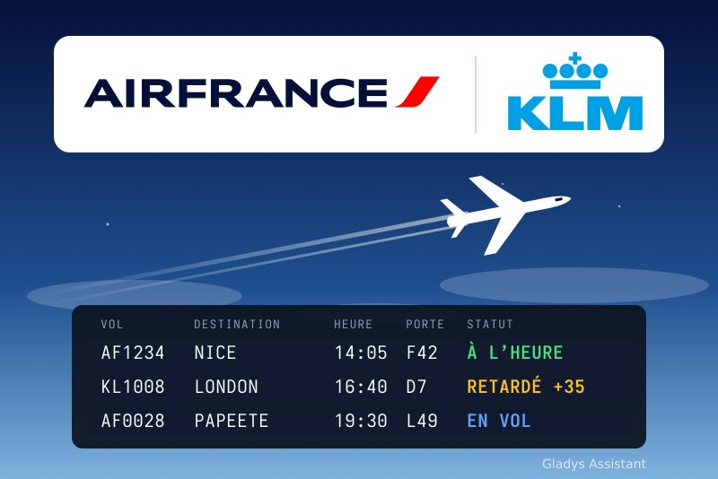
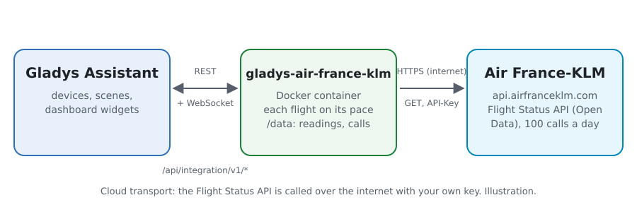
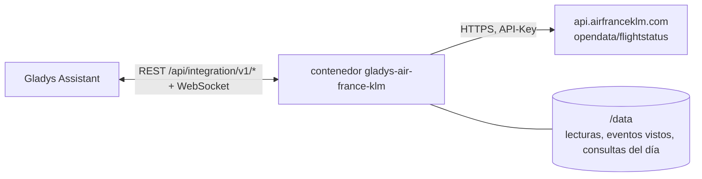
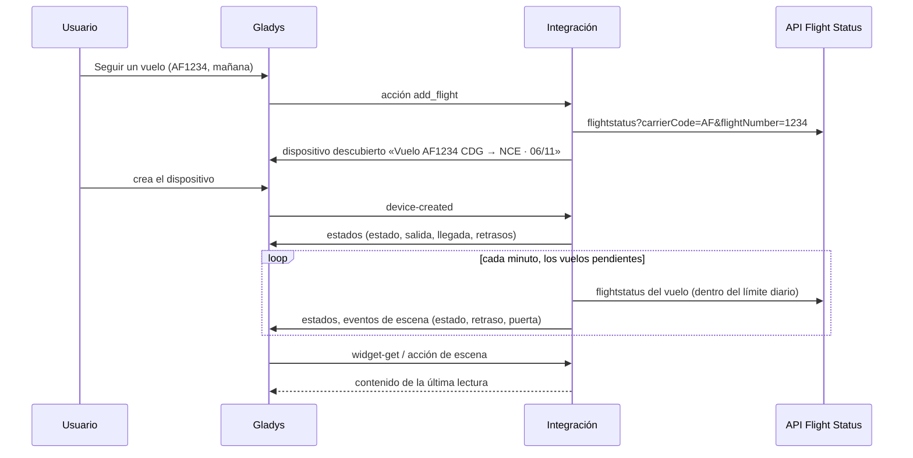
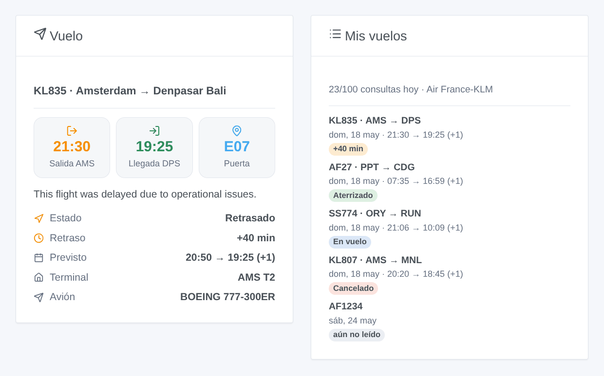

# Gladys Air France-KLM

[English](README.md) · [Français](README.fr.md) · [Deutsch](README.de.md) · **Español**

[](LICENSE)
[](https://github.com/William-De71/gladys-air-france-klm/releases)
[](https://github.com/William-De71/gladys-air-france-klm/actions/workflows/release.yml)
[](https://gladysassistant.com)



Integración externa de [Gladys Assistant](https://gladysassistant.com) para los **vuelos de Air France y KLM**: siga sus vuelos (estado, retrasos, puerta, cinta de equipaje) y reciba un aviso cuando se retrasan, despegan, aterrizan o cambian de puerta, con escenas y widgets del panel. Lee la API oficial Flight Status de Air France-KLM con la clave gratuita de su propia aplicación.

Documentación de usuario: [English](docs/en.md) · [Français](docs/fr.md) · [Deutsch](docs/de.md) · [Español](docs/es.md).

> Integración comunitaria, no afiliada a Air France, KLM ni al grupo Air France-KLM, ni respaldada por ellos. Air France, KLM y sus logotipos son marcas de sus propietarios.

## Funcionalidades

- **Un dispositivo por vuelo en seguimiento** (hasta 10, añadidos con el botón **Seguir un vuelo**): un número de vuelo (AF1234, KL 1008) y su fecha, y para un vuelo con escala los aeropuertos donde embarca y baja.
- Por vuelo: el estado (a tiempo, retrasado, en vuelo, aterrizado, cancelado, desviado), la salida y la llegada (hora local, hora prevista, terminal, puerta, cinta de equipaje) y los retrasos de salida y llegada en minutos.
- **3 disparadores de escena**, **2 acciones de escena** y **2 widgets** (abajo), con el motivo de un retraso o una cancelación dado por la aerolínea.
- Cada vuelo se lee con más frecuencia a medida que se acerca la salida (cada 12 horas unos días antes, cada 15 minutos en las dos últimas horas), nunca más una vez aterrizado, dentro de un límite diario de consultas (100 en el plan gratuito). Las lecturas y las consultas del día se guardan en `/data` entre reinicios.
- Botones de configuración: probar la conexión, seguir / dejar de seguir / listar los vuelos.
- Cuatro idiomas en todas partes: inglés, francés, alemán, español.

## Funcionamiento





La API Flight Status devuelve, para un número de vuelo en torno a una fecha, el vuelo operado: su trayecto, un tramo por etapa, las horas previstas, últimas publicadas y reales en la hora local de cada aeropuerto, la terminal, la puerta y la cinta de equipaje, los retrasos y sus motivos públicos. La integración elige el vuelo de la fecha seguida (y los tramos entre los aeropuertos elegidos), deduce un estado de las horas reales y del estado del vuelo, y lo compara con la lectura anterior para lanzar los disparadores de escena.



### Transporte

Solo en la nube (`"transports": ["cloud"]`): el catálogo muestra la insignia de nube. La integración contacta `api.airfranceklm.com` con su clave; solo se envían los números y fechas de los vuelos en seguimiento. No existe acceso local, así que no hay botón «Preferir la conexión local».

## Dispositivos y funciones

| Dispositivo                               | Función               | Categoría / tipo       | Valores                                             |
| ----------------------------------------- | --------------------- | ---------------------- | --------------------------------------------------- |
| Vuelo \<número\> \<trayecto\> · \<fecha\> | Estado del vuelo      | `text` / `text`        | «Retrasado», «En vuelo», «Aterrizado»…              |
| Vuelo \<número\> \<trayecto\> · \<fecha\> | Salida                | `text` / `text`        | «14:35 (prevista 14:05) · CDG T2F · puerta F42»     |
| Vuelo \<número\> \<trayecto\> · \<fecha\> | Llegada               | `text` / `text`        | «16:10 · NCE T2 · cinta 5», «(+1)» al día siguiente |
| Vuelo \<número\> \<trayecto\> · \<fecha\> | Retraso en la salida  | `duration` / `integer` | minutos, −2880 … 2880 (negativo si se adelanta)     |
| Vuelo \<número\> \<trayecto\> · \<fecha\> | Retraso en la llegada | `duration` / `integer` | minutos, −2880 … 2880                               |

El identificador externo de un dispositivo es un identificador aleatorio asignado al seguir el vuelo, nunca un número de vuelo: AF1234 vuela todos los días, cada fecha tiene su propio dispositivo.

## Disparadores, acciones de escena y widgets



**Disparadores de escena** (la primera lectura de un vuelo sirve de referencia y no dispara nada):

- **Estado del vuelo cambiado**: retrasado, despegó, aterrizó, cancelado o desviado, con el estado anterior, las horas, la puerta, el retraso, el motivo y un resumen. Filtros: vuelo, nuevo estado.
- **Retraso del vuelo cambiado**: el retraso cambió 15 minutos o más (el de la salida hasta el despegue, el de la llegada después). Filtro: vuelo.
- **Puerta anunciada o cambiada**: con la puerta anterior y la terminal. Filtro: vuelo.

**Acciones de escena**: **Leer un vuelo en seguimiento** (se vuelve a leer si tiene más de 10 minutos) y **Consultar un vuelo** en una fecha sin seguirlo; ambas dan el estado, las horas, los retrasos, la puerta, la cinta, el avión, el motivo y un resumen.

**Widgets**: **Vuelo** (las horas, la puerta o la cinta, el estado, el retraso, los horarios previstos, las terminales, el avión y el motivo de un retraso) y **Mis vuelos** (todos los vuelos en seguimiento con su insignia de estado, y las consultas usadas hoy).

Ejemplos:

- Cuando el estado de «Vuelo AF1234» pasa a **Retrasado** → enviar `{{triggerEvent.data.summary}}` a su teléfono.
- Cuando el vuelo de vuelta pasa a **Aterrizado** → encender la calefacción y la luz de la entrada.
- Cuando se **anuncia la puerta** → hacer decir «Puerta `{{triggerEvent.data.gate}}`» al altavoz.

## Requisitos

- Gladys Assistant **5.3.0** o posterior (widgets y disparadores de escena de las integraciones externas, palabras clave del catálogo de Gladys 5.3). Las instancias más antiguas no pueden instalar la integración.
- Una clave gratuita de la API Flight Status: una cuenta en [developer.airfranceklm.com](https://developer.airfranceklm.com) y una aplicación suscrita a **Flight Status**.

## Instalación

- **Desde la tienda** de Gladys (Integraciones → Integraciones externas), en un clic, una vez indexada.
- **Desde la URL del repositorio**: `https://github.com/William-De71/gladys-air-france-klm`.
- **Modo desarrollador**: construya la imagen en local (`docker build -t gladys-air-france-klm .`) e instálela desde Gladys.

## Configuración

| Campo / botón                | Descripción                                                                                                              |
| ---------------------------- | ------------------------------------------------------------------------------------------------------------------------ |
| Clave de API                 | La clave de su aplicación Air France-KLM (no el secreto).                                                                |
| Consultas al día como máximo | 100 en el plan gratuito; las lecturas automáticas se detienen 5 consultas antes.                                         |
| Idioma de los textos         | Nombres de los dispositivos, estados, resúmenes de escenas y motivos de la aerolínea. Automático: el idioma del panel.   |
| Probar la conexión           | Lee un vuelo para comprobar la clave e indica las consultas usadas hoy.                                                  |
| Seguir un vuelo              | Número de vuelo, fecha de salida (06/11, mañana, +3) y, para un vuelo con escala, los aeropuertos de embarque y llegada. |
| Dejar de seguir un vuelo     | Por su número en **Listar los vuelos**, o su número de vuelo; su dispositivo permanece hasta que lo elimine.             |
| Listar los vuelos            | Los vuelos en seguimiento con su trayecto y estado, y las consultas del día.                                             |

Los vuelos se guardan en la configuración de Gladys, por lo que siguen sus copias de seguridad; un vuelo sale de la lista 3 días después de su fecha.

## Uso

1. Pegue la clave de su aplicación, guarde y pulse **Probar la conexión**.
2. Pulse **Seguir un vuelo**: «AF1234», «mañana».
3. En la pestaña **Descubrimiento**, cree el dispositivo «Vuelo …», añada los widgets **Vuelo** y **Mis vuelos** a un panel, y cree una escena con **Estado del vuelo cambiado**.

## Desarrollo

```bash
npm install
npm test                       # node --test, sin tocar nunca la red
npm run lint && npm run format:check
npx github:GladysAssistant/integration-store . --skip-image-check
scripts/build-cover.sh         # cover.jpg desde docs/assets/cover.svg
docs/illustrations/render.sh   # docs/assets/widgets.<idioma>.png
node .github/scripts/release.mjs next
```

En local, el SDK lee `GLADYS_HOST_API_URL`, `GLADYS_INTEGRATION_TOKEN` y `GLADYS_INTEGRATION_SELECTOR`; `AFKL_API_URL` dirige la integración a otra raíz de API (un simulacro); `DEBUG=gladys-integration-sdk` muestra los registros del SDK y comprueba cada contenido de widget. Las pruebas usan una respuesta real de la API Flight Status del 18 de mayo de 2025, reducida (`test/fixtures/`). Las reglas del proyecto están en [CLAUDE.md](CLAUDE.md).

## Proceso de publicación


Cada fusión en `main` lanza la CI y luego calcula la versión a partir de los [Conventional Commits](https://www.conventionalcommits.org/es/) desde la última etiqueta: `feat` → menor, `fix` / `perf` → parche, `!` o `BREAKING CHANGE` → mayor (una menor antes de 1.0.0); `docs`, `chore`, `ci`, `test`, `style`, `refactor`, `build` solos no publican nada. Se genera la sección del changelog, se envía la etiqueta, se construye la imagen multiarquitectura, luego `main` recibe el commit de publicación, se crea la GitHub Release y un último job comprueba la imagen pública, el validador de la tienda y el topic.

- El título de la pull request se convierte en el commit squash y luego en la línea del changelog: escríbalo en inglés, para el usuario (`pr-title.yml` lo comprueba). No edite nunca `CHANGELOG.md` a mano.
- La 1.0.0 es una decisión: Actions → Release → Run workflow con `release-as: 1.0.0`. `dry-run` muestra la versión y las notas sin publicar.
- **Rama protegida**: la publicación envía su commit a `main` con `GITHUB_TOKEN`. Con un ruleset en `main` más estricto que «ni borrado ni force-push», añada GitHub Actions a su lista de omisión (o envíe mediante una GitHub App); si no, el job de publicación falla con instrucciones.
- Tras la primera publicación, haga público el paquete `ghcr.io` (Package settings → Change visibility); si no, Gladys no puede descargarlo.

## Solución de problemas

Vea [docs/es.md](docs/es.md#solución-de-problemas). Informe de los problemas con las versiones de Gladys y de la integración, el vuelo afectado y las respuestas de **Probar la conexión** y **Listar los vuelos**.

## Contribuir

Las issues y pull requests son bienvenidas. Ejecute `npm run format:check && npm run lint && npm test` antes de abrir una pull request, y mantenga sin cambios todos los identificadores externos y claves guardadas (vea [CLAUDE.md](CLAUDE.md)).

## Seguridad

Vea [SECURITY.md](SECURITY.md): informe de las vulnerabilidades en privado. La clave de API es un campo `secret` de Gladys, nunca registrado; la integración se ejecuta en solo lectura, sin ser root, en su contenedor.

## Capturas pendientes

Las imágenes de arriba son ilustraciones, no capturas de pantalla. Las capturas reales irán en `docs/assets/screenshots/` (PNG, 1280 × 800): `configuration.png`, `discovery.png`, `device.png`, `scene.png`.

## Licencia

[Licencia Apache 2.0](LICENSE) — vea también [NOTICE](NOTICE). Los estados de los vuelos vienen de la API Flight Status de Air France-KLM, leída con la clave de la aplicación de cada usuario según las condiciones del portal de desarrolladores. Los logotipos de la portada vienen de Wikimedia Commons (marcas de Air France y KLM). Gracias a la documentación y al SDK de Gladys, y a Air France-KLM por sus API abiertas.
