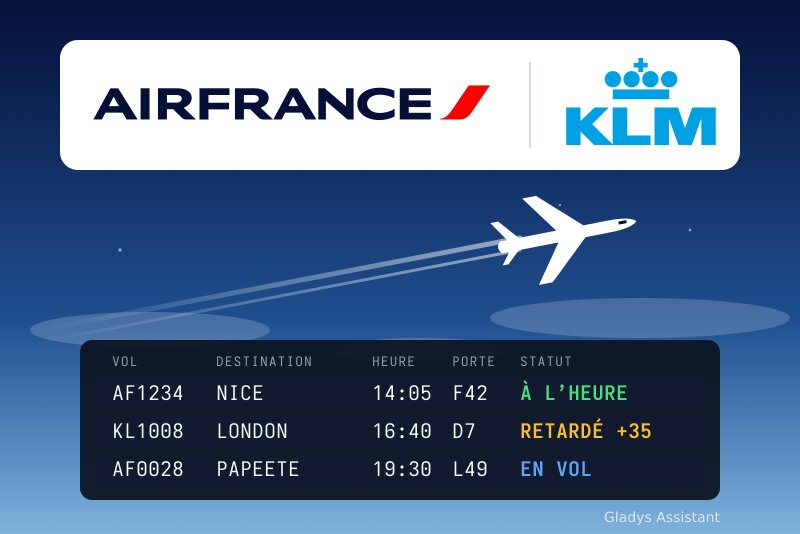
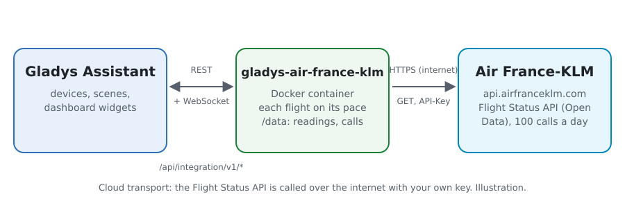
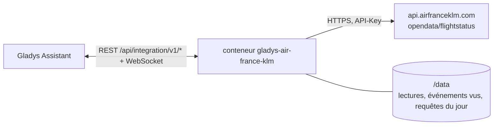
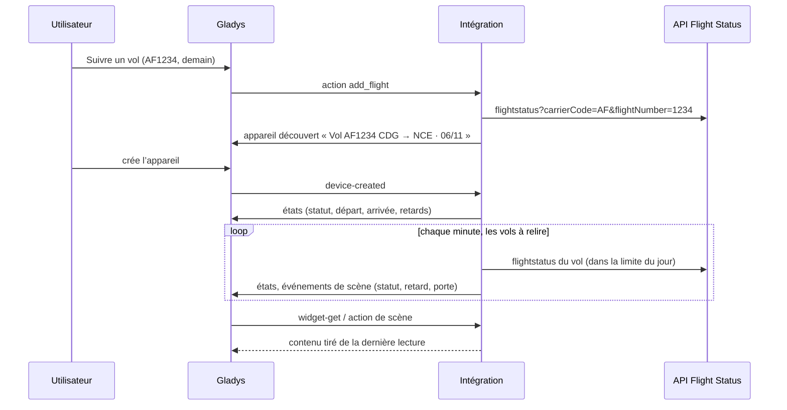
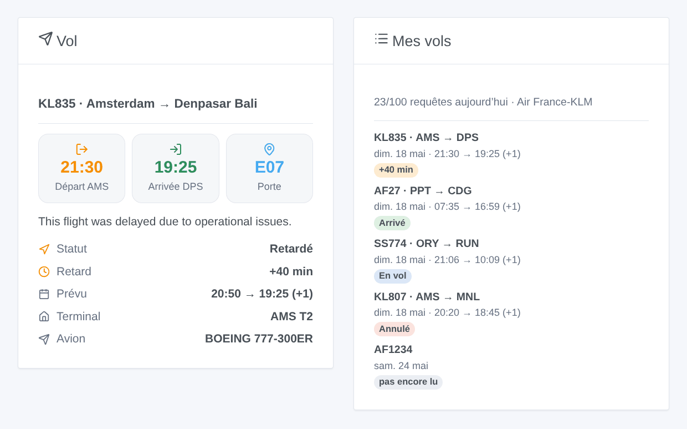

# Gladys Air France-KLM

[English](README.md) · **Français** · [Deutsch](README.de.md) · [Español](README.es.md)

[](LICENSE)
[](https://github.com/William-De71/gladys-air-france-klm/releases)
[](https://github.com/William-De71/gladys-air-france-klm/actions/workflows/release.yml)
[](https://gladysassistant.com)



Intégration externe de [Gladys Assistant](https://gladysassistant.com) pour les **vols Air France et KLM** : suivez vos vols (statut, retards, porte, tapis à bagages) et soyez prévenu quand ils sont retardés, décollent, atterrissent ou changent de porte, avec des scènes et des widgets. Elle lit l’API officielle Flight Status d’Air France-KLM avec la clé gratuite de votre propre application.

Documentation utilisateur : [English](docs/en.md) · [Français](docs/fr.md) · [Deutsch](docs/de.md) · [Español](docs/es.md).

> Intégration communautaire, non affiliée à Air France, KLM ni au groupe Air France-KLM, ni approuvée par eux. Air France, KLM et leurs logos sont des marques de leurs propriétaires.

## Fonctionnalités

- **Un appareil par vol suivi** (jusqu’à 10, ajoutés avec le bouton **Suivre un vol**) : un numéro de vol (AF1234, KL 1008) et sa date, et pour un vol avec escale les aéroports où vous embarquez et descendez.
- Par vol : le statut (à l’heure, retardé, en vol, arrivé, annulé, dérouté), le départ et l’arrivée (heure locale, heure prévue, terminal, porte, tapis à bagages) et les retards au départ et à l’arrivée en minutes.
- **3 déclencheurs de scène**, **2 actions de scène** et **2 widgets** (ci-dessous), avec le motif d’un retard ou d’une annulation donné par la compagnie.
- Chaque vol est lu plus souvent à l’approche du départ (toutes les 12 heures quelques jours avant, toutes les 15 minutes dans les deux dernières heures), plus du tout une fois arrivé, dans une limite quotidienne de requêtes (100 avec l’offre gratuite). Les lectures et les requêtes du jour sont gardées dans `/data` entre deux redémarrages.
- Boutons de configuration : tester la connexion, suivre / ne plus suivre / lister les vols.
- Quatre langues partout : anglais, français, allemand, espagnol.

## Fonctionnement





L’API Flight Status donne, pour un numéro de vol autour d’une date, le vol opéré : son trajet, une étape par tronçon, les heures prévues, dernières publiées et réelles à l’heure locale de chaque aéroport, le terminal, la porte et le tapis à bagages, les retards et leurs motifs publics. L’intégration choisit le vol de la date suivie (et les étapes entre les aéroports choisis), en déduit un statut à partir des heures réelles et du statut du vol, et le compare à la lecture précédente pour lancer les déclencheurs de scène.



### Transport

Cloud uniquement (`"transports": ["cloud"]`) : le catalogue affiche le badge cloud. L’intégration contacte `api.airfranceklm.com` avec votre clé ; seuls les numéros et dates des vols suivis sont envoyés. Il n’existe pas d’accès local, donc pas de bouton « Préférer la connexion locale ».

## Appareils et fonctionnalités

| Appareil                             | Fonctionnalité     | Catégorie / type       | Valeurs                                             |
| ------------------------------------ | ------------------ | ---------------------- | --------------------------------------------------- |
| Vol \<numéro\> \<trajet\> · \<date\> | Statut du vol      | `text` / `text`        | « Retardé », « En vol », « Arrivé »…                |
| Vol \<numéro\> \<trajet\> · \<date\> | Départ             | `text` / `text`        | « 14:35 (prévu 14:05) · CDG T2F · porte F42 »       |
| Vol \<numéro\> \<trajet\> · \<date\> | Arrivée            | `text` / `text`        | « 16:10 · NCE T2 · tapis 5 », « (+1) » le lendemain |
| Vol \<numéro\> \<trajet\> · \<date\> | Retard au départ   | `duration` / `integer` | minutes, −2880 … 2880 (négatif en cas d’avance)     |
| Vol \<numéro\> \<trajet\> · \<date\> | Retard à l’arrivée | `duration` / `integer` | minutes, −2880 … 2880                               |

L’identifiant externe d’un appareil est un identifiant aléatoire donné quand le vol est suivi, jamais un numéro de vol : AF1234 vole tous les jours, chaque date a son appareil.

## Déclencheurs, actions de scène et widgets



**Déclencheurs de scène** (la première lecture d’un vol sert de référence et ne déclenche rien) :

- **Statut du vol modifié** : retardé, décollé, arrivé, annulé ou dérouté, avec le statut précédent, les heures, la porte, le retard, le motif et un résumé. Filtres : vol, nouveau statut.
- **Retard du vol modifié** : le retard a bougé de 15 minutes ou plus (celui du départ jusqu’au décollage, celui de l’arrivée ensuite). Filtre : vol.
- **Porte annoncée ou changée** : avec la porte précédente et le terminal. Filtre : vol.

**Actions de scène** : **Lire un vol suivi** (relu s’il date de plus de 10 minutes) et **Rechercher un vol** à une date sans le suivre ; les deux donnent le statut, les heures, les retards, la porte, le tapis à bagages, l’avion, le motif et un résumé.

**Widgets** : **Vol** (les heures, la porte ou le tapis à bagages, le statut, le retard, les horaires prévus, les terminaux, l’avion et le motif d’un retard) et **Mes vols** (tous les vols suivis avec leur badge de statut, et les requêtes du jour).

Exemples :

- Quand le statut de « Vol AF1234 » passe à **Retardé** → envoyer `{{triggerEvent.data.summary}}` sur votre téléphone.
- Quand le vol retour passe à **Arrivé** → allumer le chauffage et la lumière de l’entrée.
- Quand la **porte est annoncée** → faire dire « Porte `{{triggerEvent.data.gate}}` » par l’enceinte.

## Prérequis

- Gladys Assistant **5.3.0** ou plus récent (widgets et déclencheurs de scène des intégrations externes, mots-clés du catalogue de Gladys 5.3). Les instances plus anciennes ne peuvent pas installer l’intégration.
- Une clé gratuite de l’API Flight Status : un compte sur [developer.airfranceklm.com](https://developer.airfranceklm.com) et une application abonnée à **Flight Status**.

## Installation

- **Depuis le store** de Gladys (Intégrations → Intégrations externes), en un clic, une fois indexée.
- **Depuis l’URL du dépôt** : `https://github.com/William-De71/gladys-air-france-klm`.
- **Mode développeur** : construisez l’image en local (`docker build -t gladys-air-france-klm .`) et installez-la depuis Gladys.

## Configuration

| Champ / bouton               | Description                                                                                                               |
| ---------------------------- | ------------------------------------------------------------------------------------------------------------------------- |
| Clé d’API                    | La clé de votre application Air France-KLM (pas le secret).                                                               |
| Requêtes par jour au maximum | 100 avec l’offre gratuite ; les lectures automatiques s’arrêtent 5 requêtes avant.                                        |
| Langue des textes            | Noms des appareils, statuts, résumés des scènes et motifs de la compagnie. Automatique : la langue du tableau de bord.    |
| Tester la connexion          | Lit un vol pour vérifier la clé, et donne les requêtes utilisées aujourd’hui.                                             |
| Suivre un vol                | Numéro de vol, date de départ (06/11, demain, +3) et, pour un vol avec escale, les aéroports d’embarquement et d’arrivée. |
| Ne plus suivre un vol        | Par son numéro dans **Lister les vols**, ou son numéro de vol ; son appareil reste jusqu’à ce que vous le supprimiez.     |
| Lister les vols              | Les vols suivis avec leur trajet et leur statut, et les requêtes du jour.                                                 |

Les vols sont gardés dans la configuration de Gladys et suivent donc ses sauvegardes ; un vol quitte la liste 3 jours après sa date.

## Utilisation

1. Collez la clé de votre application, enregistrez, puis appuyez sur **Tester la connexion**.
2. Appuyez sur **Suivre un vol** : « AF1234 », « demain ».
3. Dans l’onglet **Découverte**, créez l’appareil « Vol … », ajoutez les widgets **Vol** et **Mes vols** à un tableau de bord, et créez une scène sur **Statut du vol modifié**.

## Développement

```bash
npm install
npm test                       # node --test, sans jamais toucher le réseau
npm run lint && npm run format:check
npx github:GladysAssistant/integration-store . --skip-image-check
scripts/build-cover.sh         # cover.jpg depuis docs/assets/cover.svg
docs/illustrations/render.sh   # docs/assets/widgets.<langue>.png
node .github/scripts/release.mjs next
```

En local, le SDK lit `GLADYS_HOST_API_URL`, `GLADYS_INTEGRATION_TOKEN` et `GLADYS_INTEGRATION_SELECTOR` ; `AFKL_API_URL` dirige l’intégration vers une autre racine d’API (un bouchon) ; `DEBUG=gladys-integration-sdk` affiche les journaux du SDK et vérifie chaque contenu de widget. Les tests utilisent une vraie réponse de l’API Flight Status du 18 mai 2025, réduite (`test/fixtures/`). Les règles du projet sont dans [CLAUDE.md](CLAUDE.md).

## Processus de release


Chaque fusion sur `main` lance la CI, puis calcule la version à partir des [Conventional Commits](https://www.conventionalcommits.org/fr/) depuis le dernier tag : `feat` → mineure, `fix` / `perf` → correctif, `!` ou `BREAKING CHANGE` → majeure (une mineure avant 1.0.0) ; `docs`, `chore`, `ci`, `test`, `style`, `refactor`, `build` seuls ne publient rien. La section du changelog est générée, le tag poussé, l’image multi-architecture construite, puis `main` reçoit le commit de release, la GitHub Release est créée et un dernier job vérifie l’image publique, le validateur du store et le topic.

- Le titre de la pull request devient le commit squash, puis la ligne du changelog : écrivez-le en anglais, pour l’utilisateur (`pr-title.yml` le vérifie). Ne modifiez jamais `CHANGELOG.md` à la main.
- La 1.0.0 est une décision : Actions → Release → Run workflow avec `release-as: 1.0.0`. `dry-run` affiche la version et les notes sans rien publier.
- **Branche protégée** : la release pousse son commit sur `main` avec `GITHUB_TOKEN`. Avec un ruleset sur `main` plus strict que « ni suppression ni force-push », ajoutez GitHub Actions à sa liste de contournement (ou poussez via une GitHub App), sinon le job de publication échoue avec des instructions.
- Après la première release, rendez public le package `ghcr.io` (Package settings → Change visibility), sinon Gladys ne peut pas le télécharger.

## Dépannage

Voir [docs/fr.md](docs/fr.md#dépannage). Signalez les problèmes avec les versions de Gladys et de l’intégration, le vol concerné et les réponses de **Tester la connexion** et **Lister les vols**.

## Contribuer

Issues et pull requests bienvenues. Lancez `npm run format:check && npm run lint && npm test` avant d’ouvrir une pull request, et gardez inchangés tous les identifiants externes et clés stockées (voir [CLAUDE.md](CLAUDE.md)).

## Sécurité

Voir [SECURITY.md](SECURITY.md) : signalez les vulnérabilités en privé. La clé d’API est un champ `secret` de Gladys, jamais journalisé ; l’intégration tourne en lecture seule, sans être root, dans son conteneur.

## Captures à venir

Les images ci-dessus sont des illustrations, pas des captures d’écran. Les vraies captures iront dans `docs/assets/screenshots/` (PNG, 1280 × 800) : `configuration.png`, `discovery.png`, `device.png`, `scene.png`.

## Licence

[Licence Apache 2.0](LICENSE) — voir aussi [NOTICE](NOTICE). Les statuts des vols viennent de l’API Flight Status d’Air France-KLM, lue avec la clé de l’application de chaque utilisateur selon les conditions du portail développeur. Les logos de la couverture viennent de Wikimedia Commons (marques d’Air France et de KLM). Merci à la documentation et au SDK de Gladys, et à Air France-KLM pour ses API ouvertes.
