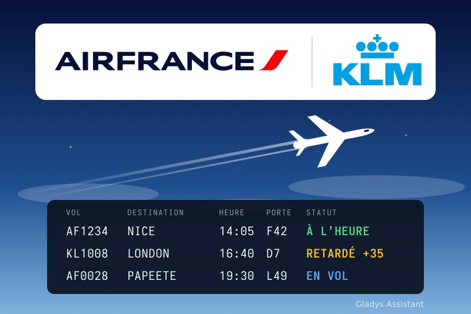
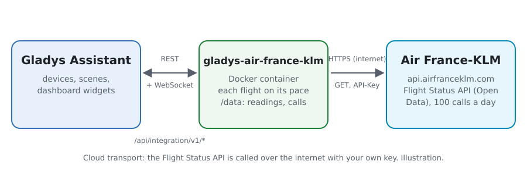
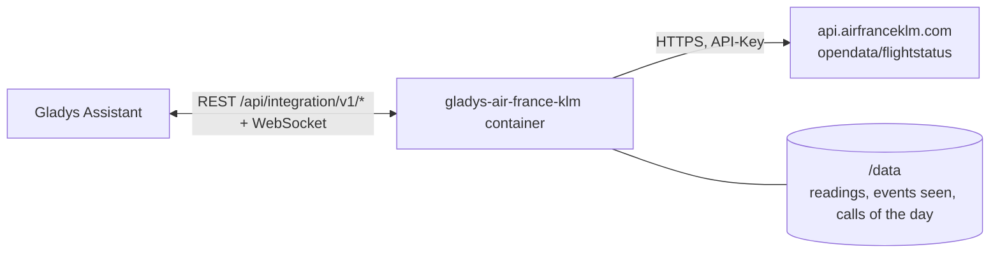
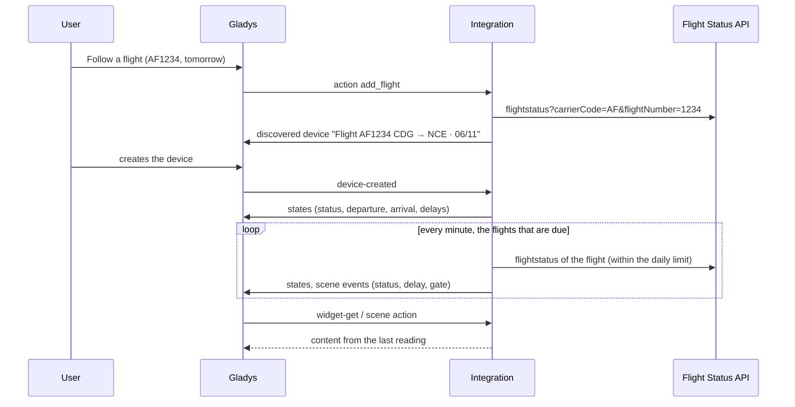
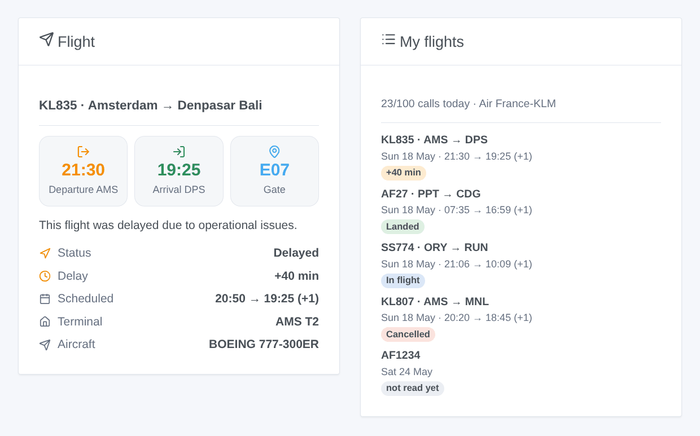

# Gladys Air France-KLM

**English** · [Français](README.fr.md) · [Deutsch](README.de.md) · [Español](README.es.md)

[](LICENSE)
[](https://github.com/William-De71/gladys-air-france-klm/releases)
[](https://github.com/William-De71/gladys-air-france-klm/actions/workflows/release.yml)
[](https://gladysassistant.com)



[Gladys Assistant](https://gladysassistant.com) external integration for **Air France and KLM flights**: follow your flights (status, delays, gate, baggage belt) and get told when they are delayed, take off, land or change gate, with scenes and dashboard widgets. It reads the official Flight Status API of Air France-KLM with the free key of your own application.

User documentation: [English](docs/en.md) · [Français](docs/fr.md) · [Deutsch](docs/de.md) · [Español](docs/es.md).

> Community integration, not affiliated with nor endorsed by Air France, KLM or the Air France-KLM group. Air France, KLM and their logos are trademarks of their owners.

## Features

- **One device per followed flight** (up to 10, added with the **Follow a flight** button): a flight number (AF1234, KL 1008) and its date, and for a flight with stops the airports you board and leave at.
- Per flight: the status (on time, delayed, in flight, landed, cancelled, diverted), the departure and arrival (local time, scheduled time, terminal, gate, baggage belt) and the departure and arrival delays in minutes.
- **3 scene triggers**, **2 scene actions** and **2 dashboard widgets** (below), with the reason of a delay or a cancellation given by the airline.
- Each flight is read more often as its departure gets closer (every 12 hours a few days ahead, every 15 minutes in the last two hours), never again once landed, within a daily limit of calls (100 on the free plan). The readings and the calls of the day are kept in `/data` across restarts.
- Configuration buttons: test the connection, follow / stop following / list the flights.
- Four languages everywhere: English, French, German, Spanish.

## How it works





The Flight Status API answers, for a flight number around a date, the operational flight: its route, one leg per hop, the scheduled, latest published and actual times in the local time of each airport, the terminal, gate and baggage belt, the delays and their public reasons. The integration picks the flight of the followed date (and the legs between the chosen airports), works out a status from the actual times and the status of the flight, and compares it with the previous reading to fire the scene triggers.



### Transport

Cloud only (`"transports": ["cloud"]`): the catalog shows the cloud badge. The integration contacts `api.airfranceklm.com` with your key; only the numbers and dates of the followed flights are sent. There is no local alternative, so there is no "prefer the local connection" button.

## Devices and features

| Device                                 | Feature         | Category / type        | Values                                         |
| -------------------------------------- | --------------- | ---------------------- | ---------------------------------------------- |
| Flight \<number\> \<route\> · \<date\> | Flight status   | `text` / `text`        | "Delayed", "In flight", "Landed"…              |
| Flight \<number\> \<route\> · \<date\> | Departure       | `text` / `text`        | "14:35 (scheduled 14:05) · CDG T2F · gate F42" |
| Flight \<number\> \<route\> · \<date\> | Arrival         | `text` / `text`        | "16:10 · NCE T2 · belt 5", "(+1)" the next day |
| Flight \<number\> \<route\> · \<date\> | Departure delay | `duration` / `integer` | minutes, −2880 … 2880 (negative when early)    |
| Flight \<number\> \<route\> · \<date\> | Arrival delay   | `duration` / `integer` | minutes, −2880 … 2880                          |

The external id of a device is a random identifier given when the flight is followed, never a flight number: AF1234 flies every day, each date is its own device.

## Scene triggers, actions and widgets



**Scene triggers** (the first reading of a flight is a reference and fires nothing):

- **Flight status changed**: delayed, took off, landed, cancelled or diverted, with the previous status, the times, the gate, the delay, the reason and a summary. Filters: flight, new status.
- **Flight delay changed**: the delay moved by 15 minutes or more (the departure one until take-off, the arrival one after). Filter: flight.
- **Gate announced or changed**: with the previous gate and the terminal. Filter: flight.

**Scene actions**: **Read a followed flight** (read again when older than 10 minutes) and **Look up a flight** on a date without following it; both give the status, the times, the delays, the gate, the baggage belt, the aircraft, the reason and a summary.

**Widgets**: **Flight** (the times, the gate or the baggage belt, the status, the delay, the scheduled times, the terminals, the aircraft and the reason of a delay) and **My flights** (every followed flight with its status badge, and the calls used today).

Examples:

- When the status of "Flight AF1234" becomes **Delayed** → send `{{triggerEvent.data.summary}}` to your phone.
- When the return flight becomes **Landed** → turn the heating and the hall light on.
- When the **gate is announced** → have the speaker say "Gate `{{triggerEvent.data.gate}}`".

## Requirements

- Gladys Assistant **5.3.0** or later (widgets and scene triggers of external integrations, catalog keywords of Gladys 5.3). Older instances cannot install the integration.
- A free key of the Flight Status API: an account on [developer.airfranceklm.com](https://developer.airfranceklm.com) and an application subscribed to **Flight Status**.

## Installation

- **From the store** of Gladys (Integrations → External integrations), in one click, once indexed.
- **From the repository URL**: `https://github.com/William-De71/gladys-air-france-klm`.
- **Developer mode**: build the image locally (`docker build -t gladys-air-france-klm .`) and install it from Gladys.

## Configuration

| Field / button          | Description                                                                                                          |
| ----------------------- | -------------------------------------------------------------------------------------------------------------------- |
| API key                 | The key of your Air France-KLM application (not the secret).                                                         |
| Calls a day at most     | 100 on the free plan; the automatic readings stop 5 calls before it.                                                 |
| Language of the texts   | Device names, statuses, scene summaries and the reasons of the airline. Automatic: the language of the dashboard.    |
| Test the connection     | Reads one flight to check the key, and gives the calls used today.                                                   |
| Follow a flight         | Flight number, departure date (06/11, tomorrow, +3), and for a flight with a stop the boarding and arrival airports. |
| Stop following a flight | By its number in **List the flights**, or its flight number; its device stays until you delete it.                   |
| List the flights        | The followed flights with their route and status, and the calls of the day.                                          |

The flights are kept in the Gladys configuration, so they follow its backups; a flight leaves the list 3 days after its date.

## Usage

1. Paste the key of your application, save, and press **Test the connection**.
2. Press **Follow a flight**: "AF1234", "tomorrow".
3. In the **Discover** tab, create the "Flight …" device, add the **Flight** and **My flights** widgets to a dashboard, and build a scene on **Flight status changed**.

## Development

```bash
npm install
npm test                       # node --test, never touches the network
npm run lint && npm run format:check
npx github:GladysAssistant/integration-store . --skip-image-check
scripts/build-cover.sh         # cover.jpg from docs/assets/cover.svg
docs/illustrations/render.sh   # docs/assets/widgets.<lang>.png
node .github/scripts/release.mjs next
```

Locally, the SDK reads `GLADYS_HOST_API_URL`, `GLADYS_INTEGRATION_TOKEN` and `GLADYS_INTEGRATION_SELECTOR`; `AFKL_API_URL` points the integration to another API root (a mock); `DEBUG=gladys-integration-sdk` shows the SDK logs and checks every widget content. The tests use a real answer of the Flight Status API for 18 May 2025, reduced (`test/fixtures/`). The rules of the project are in [CLAUDE.md](CLAUDE.md).

## Release process


Every merge on `main` runs the CI, then computes the version from the [Conventional Commits](https://www.conventionalcommits.org/) since the last tag: `feat` → minor, `fix` / `perf` → patch, `!` or `BREAKING CHANGE` → major (a minor below 1.0.0); `docs`, `chore`, `ci`, `test`, `style`, `refactor`, `build` alone publish nothing. The changelog section is generated, the tag pushed, the multi-architecture image built, then `main` receives the release commit, the GitHub Release is created and a last job checks the public image, the store validator and the topic.

- The pull request title becomes the squash commit, then the changelog line: write it in English, for the user (`pr-title.yml` checks it). Never edit `CHANGELOG.md` by hand.
- 1.0.0 is a decision: Actions → Release → Run workflow with `release-as: 1.0.0`. `dry-run` shows the version and the notes without publishing.
- **Protected branch**: the release pushes its commit to `main` with `GITHUB_TOKEN`. With a ruleset on `main` stricter than "no deletion, no force-push", add GitHub Actions to its bypass list (or push through a GitHub App), otherwise the publish job fails with instructions.
- After the first release, make the `ghcr.io` package public (Package settings → Change visibility), or Gladys cannot pull it.

## Troubleshooting

See [docs/en.md](docs/en.md#troubleshooting). Report issues with the versions of Gladys and of the integration, the flight concerned, and the answers of **Test the connection** and **List the flights**.

## Contributing

Issues and pull requests are welcome. Run `npm run format:check && npm run lint && npm test` before opening a pull request, and keep every external id and stored key unchanged (see [CLAUDE.md](CLAUDE.md)).

## Security

See [SECURITY.md](SECURITY.md): report vulnerabilities privately. The API key is a `secret` field of Gladys, never logged; the integration runs read-only, as a non-root user, in its container.

## Screenshots to come

The images above are illustrations, not screenshots. Real screenshots will go in `docs/assets/screenshots/` (PNG, 1280 × 800): `configuration.png`, `discovery.png`, `device.png`, `scene.png`.

## License

[Apache License 2.0](LICENSE) — see also [NOTICE](NOTICE). The flight statuses come from the Flight Status API of Air France-KLM, read with the key of each user's own application under the terms of the developer portal. The logos of the cover come from Wikimedia Commons (trademarks of Air France and KLM). Thanks to the Gladys documentation and SDK, and to Air France-KLM for its open data APIs.
